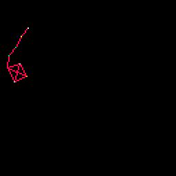
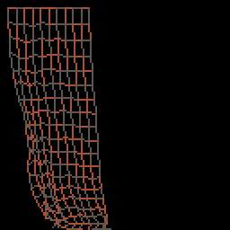
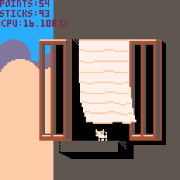
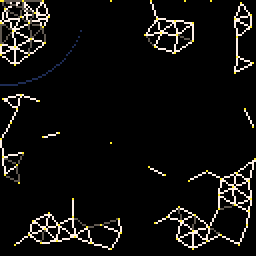
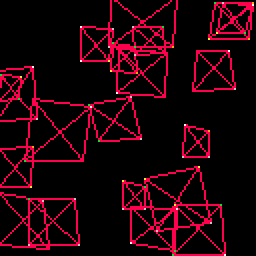
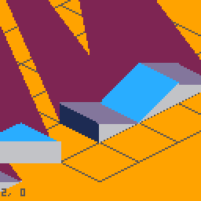
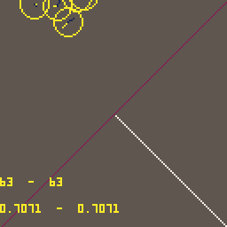

# PicoBox
Physics experiments on Pico-8

## pendulum.p8

Example of a chain linking a box to a fixed (moveable with arrow keys) point

## cloth.p8

Uses verlet integration to simulate 2d cloth physics

## windy.p8
Windy is really moody today... maybe the weather will get better if you play a little bit with her.

[Play 0.0.2](http://www.lexaloffle.com/bbs/?pid=14446&tid=2495&autoplay=1#pp)

## instable.p8

Inspired by André Michelle's instable connections
http://lab.andre-michelle.com/instable-connections

[Play 0.1](http://www.lexaloffle.com/bbs/?pid=14449&tid=2500&autoplay=1#pp)

## collisions.p8

Boxes built from verlet sticks falling onto the floor

## nanogolf

Physics engine for NanoGolf, an isometric golf game

[Play 0.0.1](http://www.lexaloffle.com/bbs/?tid=2779&autoplay=1#pp)

## reflection.p8

2d vectorial reflection with Circles + Line collision

